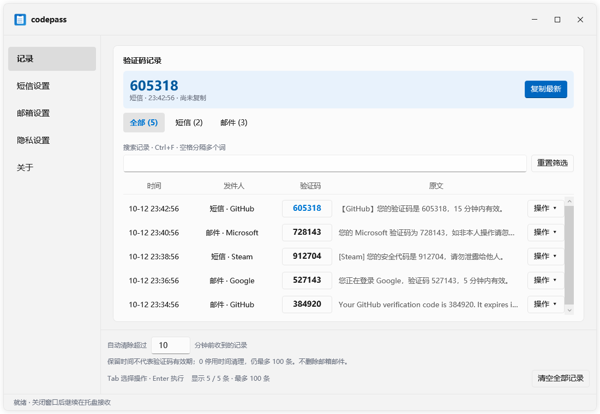
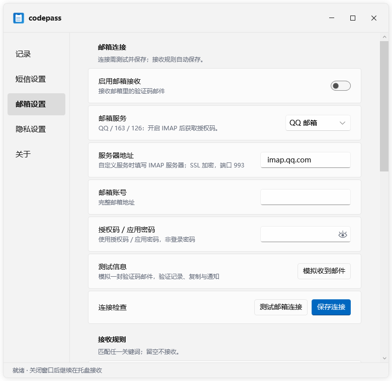
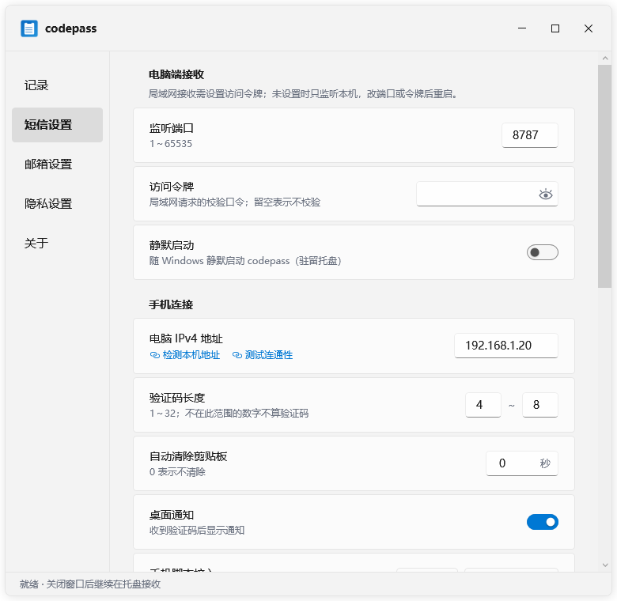
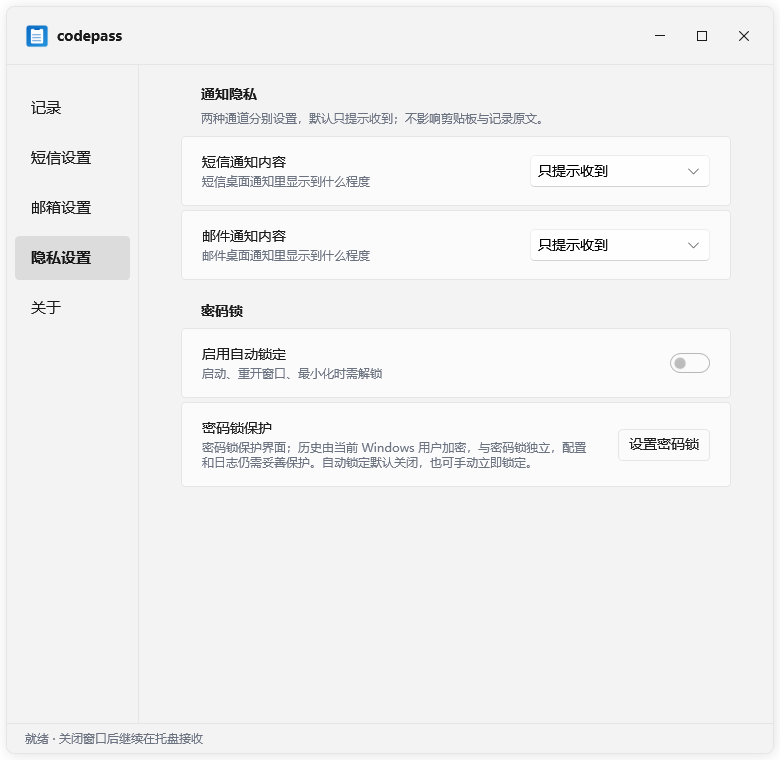

# codepass

**SMS and email verification codes, copied automatically to Windows.**

Android SMS or email code → Windows → clipboard

[Features](#features) · [Screenshots](#feature-screenshots) · [Downloads](#downloads) · [Quick Setup](#quick-setup) · [Phone Options](#phone-options)

[简体中文](README.md) · **English**

> [!WARNING]
> A personal open-source project with no support or compatibility guarantees. The Windows package is not code-signed. Read the [Disclaimer](DISCLAIMER.md) and [Privacy Notice](PRIVACY.md) before use.

## Features

- **📱 SMS codes** — Forward from Android over LAN, EasyTier or ntfy
- **📧 Email codes** — QQ, 163, 126, Gmail, Outlook and custom IMAP; read status untouched
- **📋 Auto copy** — Paste codes the moment they arrive; optional notifications and clipboard clearing
- **🕘 History** — Search, filters and original text; 10-minute cleanup by default
- **🔐 Privacy** — Notification levels, passcode lock and redacted diagnostics
- **🔄 In-app updates** — Check and install new versions in one click
- **🖥️ Tray resident** — Silent startup; copy, clear history and open settings from the tray

## Feature Screenshots

<table>
  <tr>
    <td width="50%" align="center"><b>Code history</b> </td>
    <td width="50%" align="center"><b>Email settings</b> </td>
  </tr>
  <tr>
    <td width="50%" align="center"><b>SMS settings</b> </td>
    <td width="50%" align="center"><b>Privacy settings</b> </td>
  </tr>
</table>

## Downloads

Current Windows version: **v1.0.7**; phone modules remain at v1.0.3. [Download the latest release](https://github.com/Murciee/codepass/releases/latest).

| Asset | Purpose |
| --- | --- |
| `codepass-windows.zip` | Extract and run `codepass.exe` |
| `codepass-sms-magisk.zip` | Magisk phone module |
| `codepass-lsposed-release.apk` | LSPosed phone module |
| `SHA256SUMS.txt` | Asset checksums |

Upgrade by quitting from the tray and replacing `codepass.exe`; configuration and history are preserved. v1.0.7 and later can also update in-app from the About page.

## Quick Setup

### SMS

1. Open SMS settings, enter a random access token and the PC IPv4 address, then restart.
2. Point the phone forwarder at `http://PC-IPv4:8787/sms` with the token in the `X-Token` header (see [Phone Options](#phone-options) for each method).
3. Click Test connectivity and send a test SMS for end-to-end verification.

### Email

Open Email settings, select a provider, enter the account and IMAP authorization code, test the connection, enable reception and click Save connection. Gmail setup is in [Gmail app passwords](docs/GMAIL_APP_PASSWORD.md).

Closing the window hides it to the tray; quit from the tray menu.

## Phone Options

| Phone | Guide |
| --- | --- |
| Not rooted | [No-root Webhook](phone/no-root.md) |
| Magisk | [Magisk module](phone/magisk/README.md) |
| Rooted | [Root script](phone/README.md) |
| LSPosed | [LSPosed module](phone/lsposed/README.md) |

Use one SMS forwarding method. Email reception is configured directly on Windows and needs no phone app.

## Security and Privacy

- Use a random LAN token and never expose the port to the internet.
- Use HTTPS for ntfy; a public topic is not reliable access control.
- Protect configuration, logs and notifications; never publish real codes, messages or tokens.
- History is encrypted for the current Windows user; notification masking does not change clipboard content.

## Development

See the [Windows code map](https://github.com/Murciee/codepass/blob/main/docs/ARCHITECTURE.md) for code structure, build boundaries and maintenance entry points.

## License

Released under the [MIT License](LICENSE). Also read the [Disclaimer](DISCLAIMER.md), [Privacy Notice](PRIVACY.md), [Security](SECURITY.md) and [Support](SUPPORT.md).

## Star History

