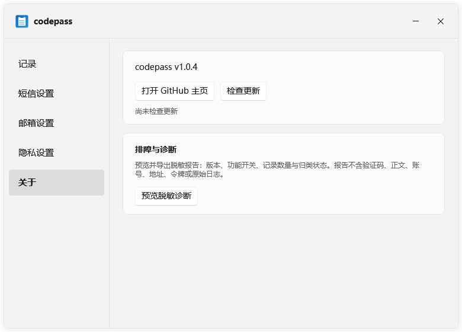

<div align="center">


# codepass

**Sync Android SMS verification codes to the Windows clipboard.**

Android phone forwards the SMS → Windows detects the code → writes it to the clipboard.

[](https://github.com/Murciee/codepass/releases/latest)
[](https://github.com/Murciee/codepass/releases)
[](#quick-start-lan-mode)
[](#recommended-setup)
[](LICENSE)
[](https://github.com/Murciee/codepass/stargazers)

[Downloads](#downloads) · [Quick Start](#quick-start-lan-mode) · [Recommended Setup](#recommended-setup) · [Public Network](#public-network-ntfy) · [Building](#building) · [FAQ](#faq) · [Documentation](#documentation-index)

[简体中文](README.md) · **English**

</div>

> [!WARNING]
> No support is provided, and compatibility or ongoing maintenance is not promised. The Windows package is not code-signed. The LSPosed release APK uses a fixed release certificate; debug and unsigned APKs are not release assets. Read the [Disclaimer](DISCLAIMER.md) and [Privacy Notice](PRIVACY.md) before use.

```text
New Android SMS → LAN / EasyTier / ntfy → Windows detects the code → clipboard
```

<div align="center">


The current sidebar contains History / SMS settings / Email settings / Privacy settings / About.

</div>

## Feature Screenshots

These screenshots come from the v1.0.4 synthetic UI verification. All displayed records are fictional and only illustrate layout and control locations.

### History search and automatic cleanup


### Email status and narrow-window layout


### SMS and privacy settings


### Redacted diagnostics entry



## Features

| Capability | Description |
| --- | --- |
| 📋 Auto copy | Writes the detected code to the clipboard, with optional desktop notification and auto-clear |
| 🌐 Two channels | LAN HTTP (default `8787`); optional ntfy relay over the internet; or an EasyTier network |
| 🖥️ Tray resident | Native single-file `codepass.exe`, depending only on the built-in .NET Framework 4.x |
| 🔐 Privacy & security | Independent SMS/email notification masking and passcode lock under Privacy settings; access token and config import/export |
| 🕘 Recent history | Up to 100 records, with 10-minute automatic cleanup by default; All / SMS / Email filters, search and click-to-copy |
| 📱 Multiple phone options | No-root Webhook, root script, Magisk, LSPosed — pick one |
| 📧 Email codes | Optional: reads verification-code emails over IMAP; QQ's new-mail popup can wake an inbox check; never marks mail as read |
| 🎨 Interface | Email status at the top, separate connection / rules / advanced cards; labels move above inputs and buttons wrap in narrow windows |
| 🩺 Redacted diagnostics | Preview and save a report from About; version, switches, counts and categorized status only, with no raw logs |

## Downloads

The current Windows version is **v1.0.4**. Phone modules remain at v1.0.3 and do not need reinstalling for this Windows update. Download installers from [GitHub Releases](https://github.com/Murciee/codepass/releases); only assets actually published there are available.

| Asset | Purpose |
| --- | --- |
| `codepass-windows.zip` | Native Windows client; extract and run `codepass.exe`, with no extra runtime installation |
| `codepass-sms-magisk.zip` | Module for phones with Magisk already installed |
| `codepass-lsposed-release.apk` | Release-signed native module for phones with LSPosed already installed |
| `SHA256SUMS.txt` | SHA-256 checksums of the three assets; checksums do not replace signature or source verification |

Only the Windows client changes in this release. Phone assets remain at v1.0.3 and are compatible.

Choose one phone option, not both modules. The `release/` directory is excluded from source commits; installers are uploaded separately as release assets.

**Upgrading:** quit Windows from the tray, replace only `codepass.exe`, and keep your configuration and history. Switching from a debug APK usually requires uninstalling it first and loses app configuration. The new LSPosed module no longer reads the old `lsposed.conf`; enter settings in the app.

### Validation limits

This Windows build passed five isolated suites with **358 checks and 0 failures**, plus an independent read-only review. Coverage includes search, redacted diagnostics, preview locking, hard-link safety, silent startup, automatic cleanup and narrow/wide geometry checks. New UI screenshots are included in this README and use fictional data. The phone modules remain the signed v1.0.3 assets; Android was not rebuilt this time. Device installation, actual SMS hooks, lock-screen/reboot behavior and Magisk installation still require device testing. See the [v1.0.4 validation record](docs/v1.0.4-validation-20261011.md).

## Recommended Setup

Most users should use “LAN + no-root Webhook”: simple, low latency, no root required.

| Phone environment | Recommended option | Notes |
| --- | --- | --- |
| 🌱 Not rooted | [No-root guide](phone/no-root.md) | Webhook apps such as SmsForwarder |
| 🧱 Magisk installed | [Magisk guide](phone/magisk/README.md) | Runs at boot; WebUI available |
| ⌨️ Rooted | [Root client](phone/README.md) | Easy to configure and debug |
| 🔌 LSPosed installed | [LSPosed guide](phone/lsposed/README.md) | Experimental; ROM-dependent |

Enable only one option to avoid duplicate messages.

## Quick Start: LAN Mode

1. **Windows**: run `codepass.exe` (single file; config lives next to the EXE). Set a random access token, select the PC IPv4 using “Detect local address”, then quit from the tray and restart. Allow “Private networks” if the firewall asks.
2. **Phone**: Webhook target `http://PC-IPv4:8787/sms`, method `POST`, body = the SMS body variable; pass the token in the `X-Token` header or a `?token=` parameter.
3. **Verify**: click “Test connectivity”, then send a test SMS — the detected code is written to the clipboard and shown on the history page.

```text
http://PC-IPv4:8787/sms
X-Token: your-token
```

> Closing the window hides it to the tray. Restart after changing the bound address, port, ntfy, or whether a token is set. Replacing an existing token applies immediately; clearing it immediately rejects LAN requests.

## Windows Settings

| Setting | Description |
| --- | --- |
| Listen port / access token | TCP port (default `8787`) and the shared LAN token |
| Start with Windows | Starts quietly in the tray after login; double-click the tray icon to open. Manual launch still shows the window |
| Automatic history cleanup | Set retention minutes in History; defaults to 10, with 0 to disable. Removes older SMS/email records, never messages from your mailbox |
| Code length | Auto-detected digit length, default 4–8, adjustable to 1–32 |
| SMS length limit | Default 500 characters, adjustable to 1–10000; longer messages are ignored without history, notification, or copying; email is unaffected |
| Auto-clear clipboard | Seconds before clearing; `0` disables |
| Desktop notification / privacy | Separate SMS and email modes: receipt only (default), mask codes with a content preview, or unmasked notification content; notifications have a length limit |
| Message filter | Line-by-line keywords or .NET regex; a match ignores that SMS |
| Email inbox | Optional: reads verification-code mail from the inbox and category folders; IDLE for the inbox where supported, interval checks for categories; sent/draft/deleted folders are excluded and mail older than ~30 minutes is skipped |
| Recent mail recheck | Changing subject/sender rules rechecks the last 30 minutes; a manual recheck is also available, with up to 200 candidates per folder and no automatic copying of old codes |
| Original text | Centered sender names; hover to preview and double-click for selectable full text; unsaved email content is labeled, and recheck/initial-backfill records are marked as history-only |
| History search / filters | All is selected by default; switch to SMS or Email. Searches sender, service, code, time and saved originals case-insensitively; space-separated terms must all match. Reset restores all records |
| QQ popup trigger | Off by default: reads only the new-mail popup title to wake an IMAP check; it does not read chat text or codes |
| Program passcode lock | Protects settings and history, with optional auto-lock |
| About & update check | Version and GitHub page; opens the download page for manual updates |
| About → redacted diagnostics | Preview the entire report, then save that exact preview as text and share it yourself. No automatic upload; no accounts, addresses, bodies, codes, tokens, rule text or raw logs |
| ntfy settings | Server, topic, and token for public-network relay |

Notes: fields save on blur or Enter. Code length, the SMS length limit, notification content, replacing an existing token, and the email / QQ popup settings apply immediately. Switching email providers pauses reception and clears the previous provider's credential; enter the new credential before enabling reception again. Restart after changing the bound address, port, ntfy, or whether a token is set. Data files live next to the EXE.

Privacy settings groups the independent SMS and email notification modes. They do not change clipboard contents or stored originals. Legacy configurations without an email mode inherit the SMS mode. Codes are masked before truncation; JSON or content where the code cannot be reliably located falls back to a hidden-content notice. Clearing history also clears the tray's latest code.

Email settings shows separate inbox/category status, processing results, recheck progress, and connection-test results. Three consecutive identical body-structure/Base64 errors or body FETCH BAD responses for the same UID skip that malformed message so later mail can proceed. Network, authorization, server NO, header-read, unexpected, and storage failures are not skipped by this mechanism. Storage errors remain visible on settings pages with a retry action; exporting settings does not clear runtime-config errors. Startup moves this app's atomic-write temporary files older than one day to the Recycle Bin.

Email settings is ordered as Live status → Connection → Receive rules → Advanced settings. Junk folders, body retention, check interval and QQ integration are grouped under Advanced. SMS settings has separate receiver, phone/processing, ntfy, filtering and configuration cards. Narrow windows move labels above inputs; the minimum window width is 780, and wider windows restore the side-by-side form.

For troubleshooting, use About → Preview redacted diagnostics. Reports include system/app versions, switches, rule counts, history counts, categorized status and the last 40 recognized event categories from this run. No disk log or full configuration is read. Saving preserves the exact preview; reopen it to refresh the report. Unsaved email bodies cannot be searched.

Set history retention at the bottom of History. The default is 10 minutes, the range is 0–43200, and `0` disables cleanup. Checks run immediately after changing the setting, every 15 seconds while running, and at the next launch for records that expired while closed. Cleanup removes local SMS/email records only, never mailbox messages or Windows clipboard history. Existing configurations also default to 10 minutes when upgrading; set `0` if you need long-term retention.

## Public Network: ntfy

When the phone and PC are not on the same network, enter the same HTTPS server, topic, and token on both devices, then restart Windows. Prefer a private authenticated service; a public topic name is not reliable access control. See [`phone/ntfy.md`](phone/ntfy.md).

## Network Interface

```http
POST http://PC-IPv4:8787/sms      # body: code / full SMS / JSON {"code":"654321"}
GET  http://PC-IPv4:8787/health   # health check, returns {"ok":true}
```

Pass the token via the `X-Token` header or `?token=`. When a token is set, both endpoints validate it and return `403` on mismatch. The body limit is about 1 MiB. Local HTTP is unencrypted — do not expose it to the internet.

## FAQ

- **Phone can't reach the PC**: confirm the same Wi-Fi / EasyTier, the PC's current IPv4 address, matching port and token, and an allowed firewall (for EasyTier use its adapter address).
- **SMS arrives but no code is detected**: confirm the SMS reached the PC and check the “Code length” range.
- **No notification and no clipboard content**: usually the clipboard is held by another program. Common culprits: game accelerators, clipboard tools (Ditto, PowerToys, Snipaste), remote control (ToDesk, Sunlogin, NetEase UU, `rdpclip`), some input methods and office suites; a reboot usually clears it.
- **Port / ntfy changes don't apply**: they apply only at startup — quit from the tray and restart.
- **Forwarding stops after screen lock**: disable battery optimization, allow autostart and background running, and lock the task in recents.
- **Email codes never arrive**: enable IMAP in the mailbox web settings and use the generated authorization code or app password (not the web login password); the email subject must contain a keyword such as “verification code”. Gmail setup is documented in [`docs/GMAIL_APP_PASSWORD.md`](docs/GMAIL_APP_PASSWORD.md).
- **Can't find a service's code**: select All in History and search the service name or code. Unsaved email bodies can only be found by sender, code or time. Search covers at most the 100 currently retained records.
- **Need to share troubleshooting information**: preview and save redacted diagnostics from About. Configuration export is for migration; do not share it or the complete `app.log` as a diagnostic report.

## Security and Risk

- LAN reception requires a random access token. An empty token binds only to loopback; never expose the port to the internet;
- Never commit the ntfy topic or token to a public repository; the server must use HTTPS;
- Current history uses Windows current-user DPAPI encryption. Legacy plaintext migrates on the next successful save; it cannot be read directly on another machine or user. Protect config, logs and migration exports;
- The passcode lock protects the UI, independently of history encryption. Notification masking does not change clipboard content; diagnostic export never uploads automatically.

**This is a personal open-source tool provided “as is”, with no support or maintenance promised.** Before use, read the [Disclaimer](DISCLAIMER.md), [Privacy Notice](PRIVACY.md), [Third-Party Notices](THIRD_PARTY_NOTICES.md), [Security](SECURITY.md), and [Support](SUPPORT.md) policies. Released under the [MIT License](LICENSE).

## Building

| Target | Command | Artifact |
| --- | --- | --- |
| Windows native single file | `windows\build.ps1` | `windows/dist/codepass.exe` |
| Windows synthetic regression | `powershell -NoProfile -ExecutionPolicy Bypass -File windows\tests\Run-All.ps1` | Isolated EXE, logs, and `summary.json` under `windows/build/regression-*` |
| LSPosed native module (development test) | `phone\lsposed\build.ps1` | `phone/lsposed/app/build/outputs/apk/debug/app-debug.apk` |
| Magisk module | `phone\magisk\build.ps1` | `release/codepass-sms-magisk.zip` |

LSPosed release build: use `-Release -SignAndroid -AndroidKeystore <file> -AndroidKeyAlias <alias>` with the `CODEPASS_ANDROID_STORE_PASSWORD` / `CODEPASS_ANDROID_KEY_PASSWORD` environment variables, producing `release/codepass-lsposed-release.apk`. The build environment is provided via `JAVA_HOME`, `ANDROID_HOME`, etc. See [`docs/BUILD_ANDROID.md`](docs/BUILD_ANDROID.md).

Windows builds check version declarations in both READMEs, CHANGELOG, and release notes, stamp the assembly, and emit a build ID and `build-info.json` with the EXE SHA-256. Regression uses synthetic mail/SMS and isolated folders without connecting to a live mailbox; its own fixtures are recycled while the EXE and reports are retained. See [Windows regression and build identity](docs/windows-regression.md).

## Repository Layout

```text
windows/  Native Windows client (maintained main line)   phone/  Phone options
release/  Release artifacts                              docs/   Release / build / compliance docs
tools/    Pre-release check scripts                      assets/ Images for docs and UI
```

Only the currently maintained native Windows client, Magisk module, and native LSPosed module are retained.

## Documentation Index

- Usage: [No-root](phone/no-root.md) · [Magisk](phone/magisk/README.md) · [LSPosed](phone/lsposed/README.md) · [Root / script](phone/README.md) · [ntfy](phone/ntfy.md)
- Release & compliance: [Release checklist](docs/RELEASE_CHECKLIST.md) · [Release notes template](docs/RELEASE_NOTES.md) · [Build environment](docs/BUILD_ANDROID.md) · [Changelog](CHANGELOG.md)
- Windows validation: [Regression and build identity](docs/windows-regression.md) · [v1.0.4 validation record](docs/v1.0.4-validation-20261011.md)

## Star History

[](https://star-history.com/#Murciee/codepass&Date)

<div align="center">

**[⬆ Back to top](#codepass)**

</div>
