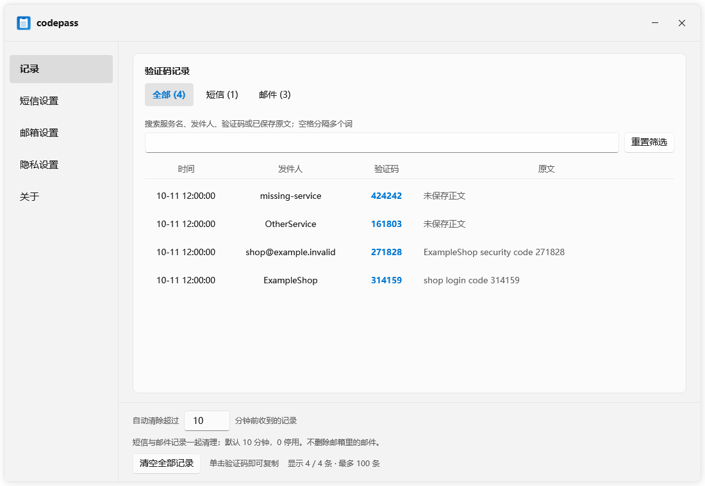
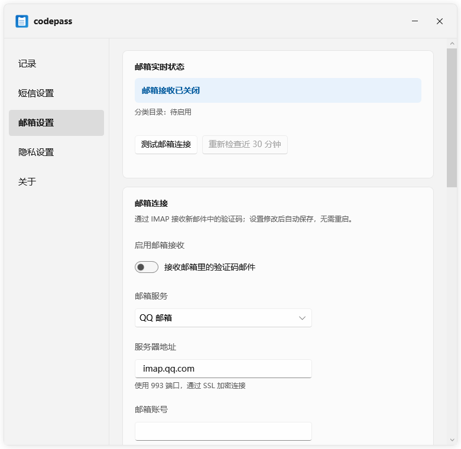
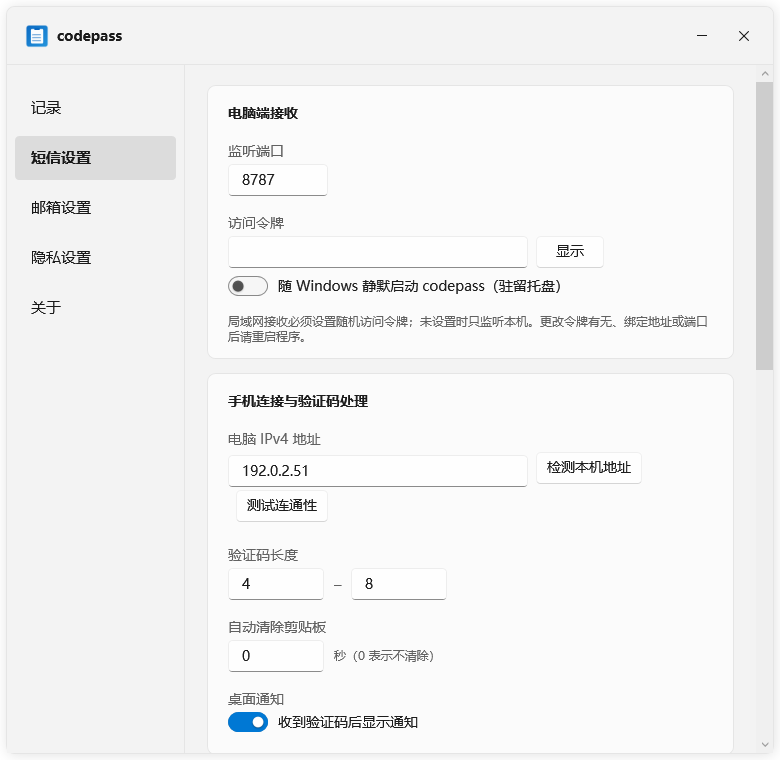
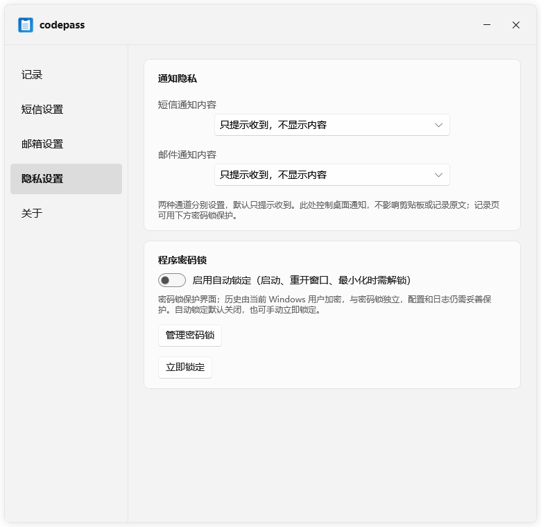

# codepass

**短信与邮箱验证码，自动复制到 Windows 剪贴板。**

Android 短信或邮箱验证码 → Windows → 剪贴板

[功能](#主要功能) · [截图](#功能截图) · [下载](#下载) · [快速接入](#快速接入) · [设置](#设置) · [常见问题](#常见问题)

**简体中文** · [English](README.en.md)

> [!WARNING]
> 个人开源项目，不承诺售后与兼容性。Windows 包未做代码签名。使用前请阅读 [免责声明](DISCLAIMER.md) 与 [隐私说明](PRIVACY.md)。

## 主要功能

| 能力 | 说明 |
| --- | --- |
| 📱 短信验证码 | Android 转发，支持局域网、EasyTier 和 ntfy |
| 📧 邮箱验证码 | 支持 QQ、163、126、Gmail、Outlook 及自定义 IMAP，不改动邮件已读状态 |
| 📋 自动复制 | 收到验证码即可粘贴，可选通知与剪贴板自动清空 |
| 🕘 记录管理 | 搜索、短信/邮件筛选、原文查看；默认 10 分钟自动清理，`0` 停用 |
| 🔐 隐私 | 短信与邮件分别设置通知内容，支持密码锁和脱敏诊断 |
| 🖥️ 托盘运行 | 静默开机启动，双击托盘打开；窗口可调整大小 |

## 功能截图

<table>
  <tr>
    <td width="50%" align="center"><b>验证码记录</b> </td>
    <td width="50%" align="center"><b>邮箱设置</b> </td>
  </tr>
  <tr>
    <td width="50%" align="center"><b>短信设置</b> </td>
    <td width="50%" align="center"><b>隐私设置</b> </td>
  </tr>
</table>

## 下载

当前 Windows 版本为 **v1.0.4**，手机模块保持 v1.0.3，无需重新安装。前往 [GitHub Releases](https://github.com/Murciee/codepass/releases/latest) 下载。

| 文件 | 用途 |
| --- | --- |
| `codepass-windows.zip` | Windows 客户端，解压运行 `codepass.exe` |
| `codepass-sms-magisk.zip` | Magisk 手机模块 |
| `codepass-lsposed-release.apk` | LSPosed 手机模块 |
| `SHA256SUMS.txt` | 附件校验值 |

升级 Windows 时从托盘退出，再覆盖 `codepass.exe`，保留配置和记录。需要长期保留记录时，把自动清理设为 `0`。

## 推荐方案

| 手机环境 | 方案 |
| --- | --- |
| 未 root | [免 root Webhook](phone/no-root.md) |
| Magisk | [Magisk 模块](phone/magisk/README.md) |
| 已 root | [root 脚本](phone/README.md) |
| LSPosed | [LSPosed 模块](phone/lsposed/README.md) |

短信转发只启用一种方案。邮箱验证码直接在 Windows「邮箱设置」中配置，无需手机端。

## 快速接入

### 短信

1. 打开 Windows「短信设置」，填写随机访问令牌和电脑 IPv4，重启程序。
2. 手机 Webhook 地址：`http://电脑IPv4:8787/sms`，令牌放在 `X-Token` 请求头。
3. 点击「测试连通性」，再发送测试短信。

### 邮箱

打开「邮箱设置」，选择服务，填写账号与 IMAP 授权码/应用密码，测试连接后启用。可设置主题关键词、发件人规则和是否保存正文。Gmail 见 [应用专用密码设置](docs/GMAIL_APP_PASSWORD.md)。

关闭窗口会隐藏到托盘；完全退出使用托盘菜单。

## 设置

| 页面 | 主要选项 |
| --- | --- |
| 记录 | 搜索与分类筛选、原文查看、自动清理 |
| 短信设置 | 地址/端口/令牌、静默启动、验证码长度、过滤、ntfy、剪贴板清理 |
| 邮箱设置 | 连接状态、主题/发件人规则、复查、垃圾箱、正文保存、QQ 联动 |
| 隐私设置 | 短信/邮件通知内容、密码锁、自动锁定 |
| 关于 | 检查更新、预览并导出脱敏诊断 |

设置自动保存。网络监听和 ntfy 变更后重启；邮箱设置即时生效。记录清理只影响本地记录，不删除邮箱邮件。

## 常见问题

- **手机连不上电脑**：检查电脑 IPv4、端口、令牌和 Windows 防火墙。
- **无法复制**：检查是否有其他剪贴板工具占用剪贴板。
- **邮箱漏收**：查看连接状态与筛选规则，必要时复查近 30 分钟。
- **找不到验证码**：在记录页选择「全部」，搜索服务名、发件人或验证码。
- **需要排障**：使用「关于 → 预览脱敏诊断」，不要分享完整配置或日志。

## 安全与隐私

- 局域网接收请设置随机令牌，不要把端口映射到公网。
- ntfy 使用 HTTPS；公共主题名不是可靠的访问控制。
- 配置、日志和通知可能包含敏感内容，请妥善保管。
- 记录默认使用 Windows 当前用户保护；通知脱敏不改变剪贴板内容。

## 手机端

- [免 root Webhook](phone/no-root.md)
- [Magisk](phone/magisk/README.md)
- [LSPosed](phone/lsposed/README.md)
- [root / 脚本](phone/README.md)
- [ntfy](phone/ntfy.md)

## 许可

本项目使用 [MIT License](LICENSE)。另请阅读 [免责声明](DISCLAIMER.md)、[隐私说明](PRIVACY.md)、[安全问题](SECURITY.md) 和 [维护说明](SUPPORT.md)。

## 社区

感谢 [LINUX DO](https://linux.do) 社区提供开放、友善的技术交流平台。

## Star History

