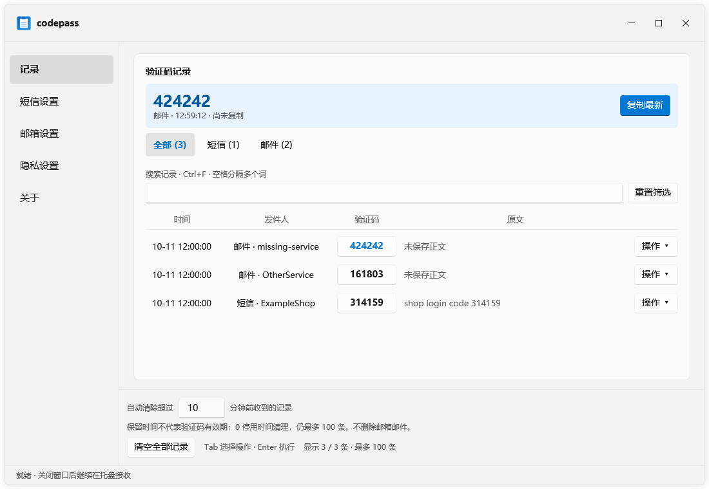

# codepass

**短信与邮箱验证码，自动复制到 Windows 剪贴板**

Android 短信或邮箱验证码 → Windows → 剪贴板

[功能](#核心功能) · [下载](#下载) · [快速开始](#快速开始) · [手机接入](#手机接入) · [常见问题](#常见问题)

**简体中文** · [English](README.en.md)

> [!WARNING]
> 个人开源项目，不承诺售后与兼容性。Windows 包未签名。使用前请阅读 [免责声明](DISCLAIMER.md) 与 [隐私说明](PRIVACY.md)。

## 核心功能

- **📱 短信验证码** — Android 转发，支持局域网、EasyTier 和 ntfy
- **📧 邮箱验证码** — 支持 QQ、163、126、Gmail、Outlook 及自定义 IMAP，不改动已读状态
- **📋 自动复制** — 收到验证码即可粘贴，可选通知与剪贴板自动清空
- **🕘 记录管理** — 搜索、筛选、原文查看；默认 10 分钟自动清理
- **🔐 隐私保护** — 通知脱敏、密码锁、脱敏诊断
- **🖥️ 托盘运行** — 静默启动，托盘菜单快速操作

## 功能截图

<table>
  <tr>
    <td width="50%" align="center"><b>验证码记录</b> </td>
    <td width="50%" align="center"><b>邮箱设置</b> </td>
  </tr>
  <tr>
    <td width="50%" align="center"><b>短信设置</b> </td>
    <td width="50%" align="center"><b>隐私设置</b> </td>
  </tr>
</table>

## 下载

前往 [GitHub Releases](https://github.com/Murciee/codepass/releases/latest) 下载最新版本 **v1.0.7**。

| 文件 | 用途 |
| --- | --- |
| `codepass-windows.zip` | Windows 客户端，解压运行 `codepass.exe` |
| `codepass-sms-magisk.zip` | Magisk 手机模块 |
| `codepass-lsposed-release.apk` | LSPosed 手机模块 |

升级 Windows 时关闭托盘，覆盖 `codepass.exe`；配置和记录自动保留。

## 快速开始

### 邮箱验证码

1. 打开「邮箱设置」，选择服务，填写账号与 IMAP 授权码
2. 测试连接，勾选「启用邮箱验证码」，点击「保存连接」

Gmail 授权码设置见 [应用专用密码教程](docs/GMAIL_APP_PASSWORD.md)。

### 短信验证码

1. 打开「短信设置」，填写随机访问令牌和电脑 IPv4
2. 手机端配置 Webhook：`http://电脑IPv4:8787/sms`，令牌放 `X-Token` 请求头
3. 点击「测试连通性」，发送测试短信验证

手机接入方案见下节。

## 手机接入

| 手机环境 | 方案 | 说明 |
| --- | --- | --- |
| 未 root | [Webhook](phone/no-root.md) | 需短信转发 App |
| Magisk | [Magisk 模块](phone/magisk/README.md) | 推荐 |
| 已 root | [root 脚本](phone/README.md) | 直接安装 |
| LSPosed | [LSPosed 模块](phone/lsposed/README.md) | Xposed 框架 |

短信转发只启用一种方案。邮箱无需手机端。

## 设置说明

| 功能 | 说明 |
| --- | --- |
| **记录** | 搜索、短信/邮件筛选、原文查看、自动清理（默认 10 分钟，`0` 停用） |
| **短信** | 连接配置、验证码长度、过滤规则、ntfy 公共中转、剪贴板清理 |
| **邮箱** | 服务选择、授权码、主题/发件人规则、复查、垃圾箱检查、QQ 联动 |
| **隐私** | 通知脱敏（短信/邮件分开设置）、密码锁、自动锁定 |
| **关于** | 检查更新、脱敏诊断导出 |

普通设置自动保存，邮箱连接需点击「保存连接」。记录自动清理不删除邮箱邮件，停用时间清理后仍最多保留 100 条。

托盘菜单支持快速复制最新验证码、查看记录、暂停自动复制 15 分钟、清空记录、打开设置、检查更新。

## 常见问题

**手机连不上电脑**  
检查电脑 IPv4、端口、令牌和 Windows 防火墙。

**无法复制**  
检查是否有其他剪贴板工具占用。

**邮箱漏收**  
查看连接状态与筛选规则，可复查近 30 分钟邮件。

**找不到验证码**  
记录页选择「全部」，搜索服务名、发件人或验证码。

**排障诊断**  
使用「关于 → 预览脱敏诊断」，不要直接分享完整配置或日志。

## 安全与隐私

- 局域网接收需设置随机令牌，勿将端口映射到公网
- ntfy 使用 HTTPS，公共主题名不是可靠的访问控制
- 配置、日志和通知可能包含敏感内容，妥善保管
- 记录使用 Windows 当前用户保护，通知脱敏不改变剪贴板内容

## 开发维护

代码结构、构建流程和维护入口见 [代码地图](docs/ARCHITECTURE.md)。

## 许可

本项目使用 [MIT License](LICENSE)。另请阅读 [免责声明](DISCLAIMER.md)、[隐私说明](PRIVACY.md)、[安全问题](SECURITY.md) 和 [维护说明](SUPPORT.md)。

## 社区

感谢 [LINUX DO](https://linux.do) 社区提供技术交流平台。

## Star History

